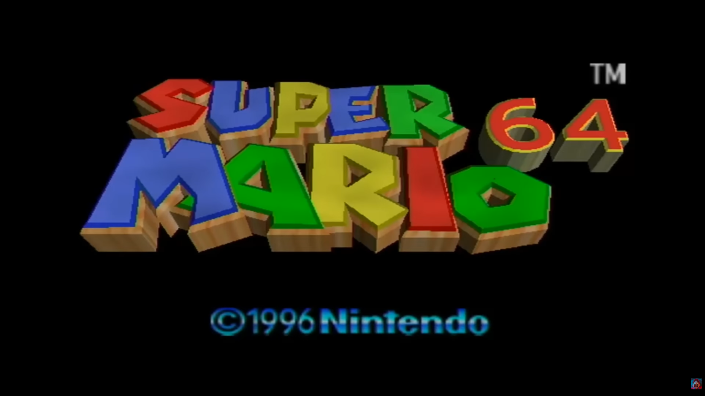
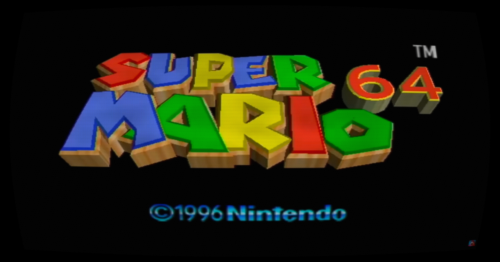
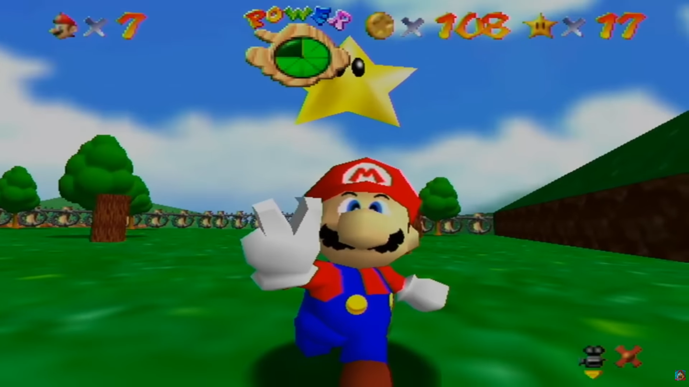
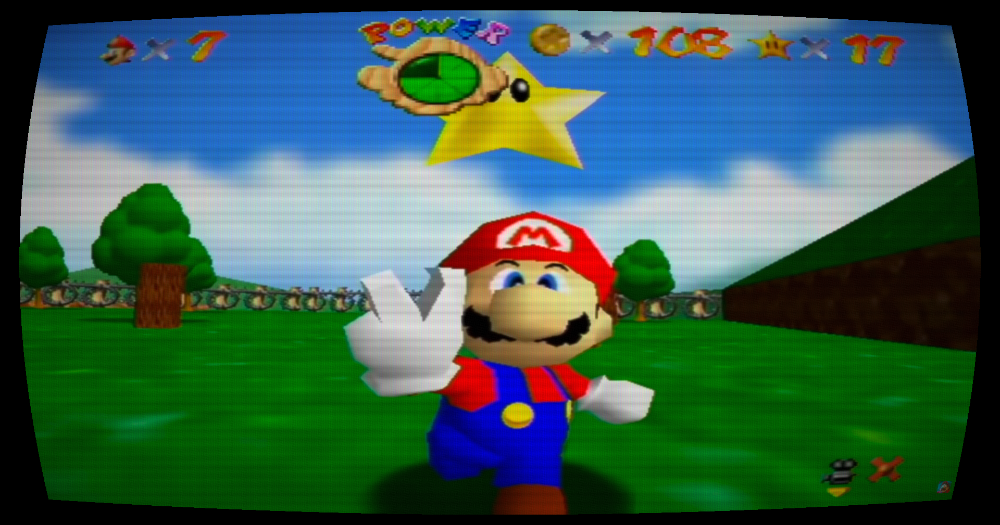
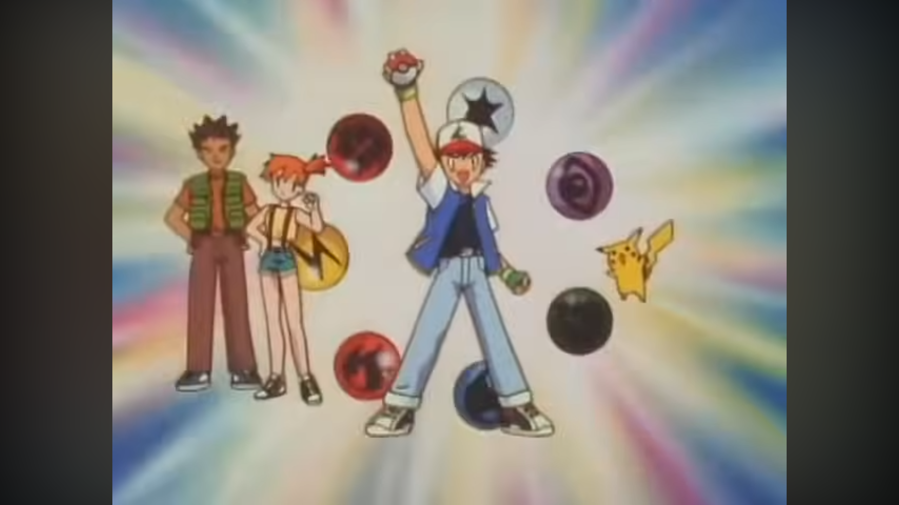
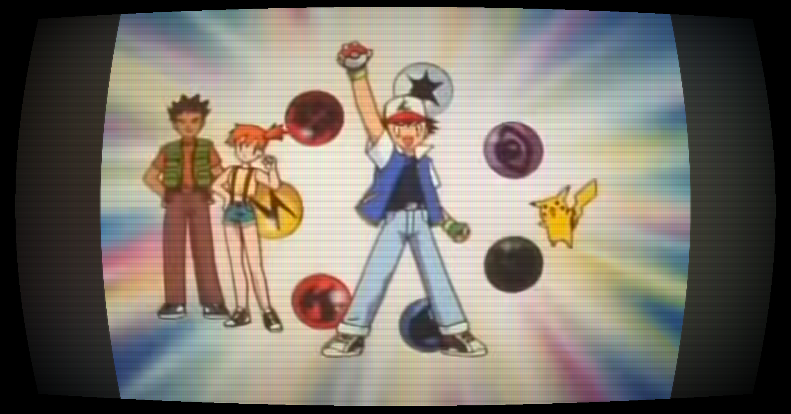
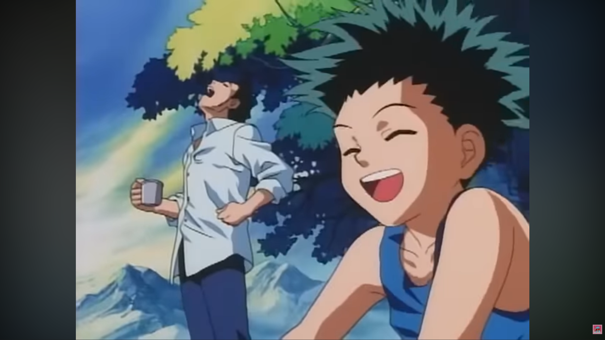
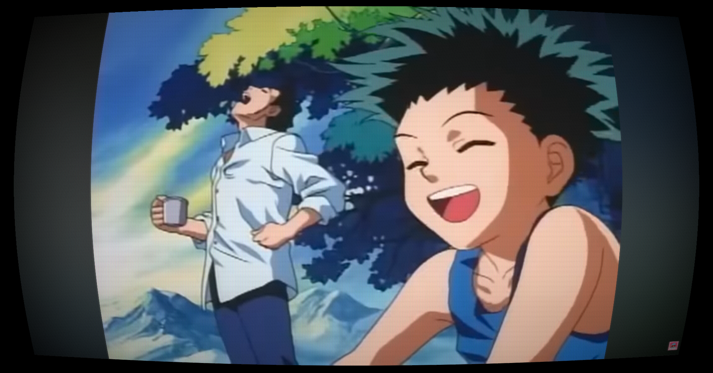

# SeeRT Overlay

It's a Saturday afternoon, and you have the hankering to play a classic game from your childhood - Super Mario 64! You boot up the game on your PC and notice the characters look a little too "angular" for your nostalgia causing the experience to lack some of the character from days gone by. No problem, I'll just switch on some classic anime instead! Oh, well the colors aren't as vibrant and it's missing that "glow"... 

Wouldn't it be nice to view retro media in the format it was designed to be played/viewed in? Wouldn't it be nice to make your very nice 4k monitor wildly antiquated? Wouldn't it be nice for your monitor to still have scanlines and static to further distort your view? 

Well me too! Enter - SeeRT!

## A short foreward...
I've been in my "better practice an agentic workflow within development to stay up with the times" arc, so this project was prompted probably 90% using Claude, me only tweaking a few things here and there and running a few commands when Claude seemed to get stuck.

## What is it?
A Windows CRT monitor overlay that applies a real-time shader filter over any window or monitor. The filter runs in a transparent, click-through DirectComposition overlay, the target application sees no performance impact and requires no modification.


<table>
  <tr>
    <td align="center"><b>Before</b></td>
    <td align="center"><b>After</b></td>
  </tr>
  <tr>
    <td></td>
    <td></td>
  </tr>
  <tr>
    <td></td>
    <td></td>
  </tr>
  <tr>
    <td></td>
    <td></td>
  </tr>
  <tr>
    <td></td>
    <td></td>
  </tr>
</table>

(P.S. I didn't want to boot my emulator for this, but thanks to "packattack04082"
on youtube for the gameplay I got my screenshots from!)


## Getting it

Download the latest `SeeRT-Overlay-vX.Y.Z-win64.zip` from [Releases](https://github.com/lanecwheeler/SeeRT-Overlay/releases), unzip it anywhere and run `SeeRTOverlay.exe`. It sits in the system tray; shake the mouse or use the tray icon to open the settings.

- Windows 10 or 11 (64-bit)
- Needs the [Microsoft Visual C++ Redistributable (x64)](https://aka.ms/vs/17/release/vc_redist.x64.exe) — most PCs already have it
- The app isn't code-signed, so Windows SmartScreen may warn the first time you run it

After that it keeps itself up to date (see below).

## Features

**Shader pipeline** (RetroArch-inspired, gamma-correct)
- Barrel/pincushion distortion with zoom compensation and rounded, anti-aliased tube corners
- Gaussian beam scanlines that follow the screen curvature, widen with brightness, and keep overall brightness
- Optional per-line colour resolve, so each scanline carries one colour like a real low-resolution signal
- Pixel-aligned phosphor masks — aperture grille, shadow mask, staggered slot mask, and 2-pixel magenta/green — with brightness compensation
- Separate CRT (2.4) and display (2.2) gamma
- Glow and halation from separable Gaussian blur passes on a downsampled, linear-light picture
- Composite colour bleed — NTSC-style YIQ bandwidth limits (colour smears, detail stays)
- RGB convergence error (chromatic aberration) that grows toward the screen edges
- Phosphor persistence (fading trails behind bright moving objects) and raster bloom (the picture swells on bright scenes)
- Vignette, hum bar, flicker, and TV static
- Phosphor tint (R/G/B) for monochrome terminal looks
- Colour grading — brightness, contrast, saturation

**Overlay**
- Captures any window or monitor via Windows Graphics Capture
- Click-through when settings panel is closed; receives input when open
- Multi-monitor: add secondary overlays to additional monitors
- Custom CRT cursor rendered inside the shader (barrel-distorted with the image)
- Bring your own cursor image (PNG, CUR, ICO, BMP, GIF, JPG, TIFF) with an adjustable hotspot
- Shake mouse to reveal cursor and settings toggle button
- System tray icon
- Screenshots of the overlay as you see it (Ctrl+Shift+PrtScn or the tray menu) saved to Pictures\SeeRT — normal screen capture tools can't see the overlay
- Updates itself: on launch it asks GitHub whether a newer release exists, downloads it in the background (checking its SHA-256), then asks before installing it — Restart & update installs it and restarts, keeping your settings and presets. Turn off the automatic download, or the check itself, under Updates in the tray menu or in Menu & App (where you can also let it install without asking when you quit).
- Patch notes in Menu & App, shown by themselves the first time a new version runs
- Stream window for OBS and other capture software, optionally with the settings menu shown in it too
- Only one copy runs at a time — starting it again just opens the running copy's settings

**Settings**
- Twelve settings menu styles: Teletext, 64 Adventure, Sword & Sorcery, Vector Monitor, Arcade Service, Computer Lab, Web 1.0, CRT OSD, Camcorder, VCR, DOS Terminal and Simple — the game-style ones each hide a secret or two
- 11 built-in presets + save/load/reorder user presets
- Settings persist to `%APPDATA%\SeeRT Overlay\settings.json`
- Audio loopback capture (optional)

## Built-in Presets

| Preset | Character |
|---|---|
| Default | Balanced starting point |
| Early 2000s Laptop | Subtle, LCD-era hint of CRT |
| Arcade | Bold cabinet look — heavy scanlines, strong mask |
| Green Phosphor | P31 monochrome terminal |
| Amber Phosphor | P3 amber/orange terminal |
| Heavy CRT | Degraded 1980s boxy TV |
| crt-geom | Classic RetroArch reference implementation |
| crt-lottes | Tim Lottes' shader — crisp, fine slot mask |
| Sony PVM | Professional reference monitor, minimal artifacts |
| Trinitron | Flat aperture-grille tube, SNES/PS1 era |
| NTSC Composite | Degraded consumer signal with convergence error |

## Building

### Requirements

- Windows 10 or later
- [Visual Studio 2022+ Build Tools](https://visualstudio.microsoft.com/downloads/#build-tools-for-visual-studio-2022) with the **Desktop development with C++** workload
- [Windows SDK 10.0.26100+](https://developer.microsoft.com/en-us/windows/downloads/windows-sdk/)
- [vcpkg](https://github.com/microsoft/vcpkg) installed and available (e.g. `C:/vcpkg`)

### Steps

1. Clone the repo and open a terminal in the project root.

2. If vcpkg is not at `C:/vcpkg`, edit `CMakePresets.json` and update `toolchainFile` to point to your vcpkg installation. The preset uses the newest Visual Studio generator CMake can find.

3. Configure and build:
   ```bash
   cmake --preset default
   cmake --build --preset default
   ```

4. The executable is at `build/bin/Release/SeeRTOverlay.exe`. Shader `.cso` files, font assets, and the default cursor image are copied next to it automatically.

Dependencies (`imgui`, `nlohmann-json`) are installed automatically from `vcpkg.json` during the configure step — no manual `vcpkg install` needed.

## Releasing

Releases are built by GitHub Actions (`.github/workflows/release.yml`):

1. Set the new version in `CMakeLists.txt` — `project(SeeRTOverlay VERSION 1.5.0 ...)`.
2. Add a `## 1.5.0` section with a few short bullets to the top of `CHANGELOG.md`. Those notes are built into the app (its patch notes window) and become the "What's new" part of the release description. Keep them plain ASCII.
3. Commit, then tag that commit with the same version and push the tag:
   ```bash
   git tag v1.5.0
   git push origin v1.5.0
   ```
4. The workflow builds the app, packages `SeeRT-Overlay-v1.5.0-win64.zip` with its SHA-256, and creates a **draft** release. Review it on GitHub and press **Publish** — the in-app update check only sees published releases.

The workflow refuses to release if the tag and the version in `CMakeLists.txt` differ, since the update check compares the two. To package locally, run `powershell -ExecutionPolicy Bypass -File tools\package-release.ps1` after building (output goes to `dist\`).

## Tech Stack

| Layer | Technology |
|---|---|
| Language | C++20 |
| Renderer | Direct3D 11 |
| Shaders | HLSL 5.0 (compiled via fxc.exe) |
| Screen capture | Windows Graphics Capture (C++/WinRT) |
| UI | Dear ImGui |
| Composition | DirectComposition |
| JSON | nlohmann/json |
| Updates | WinHTTP, BCrypt (SHA-256) |
| Package manager | vcpkg (manifest mode) |

## Credits

Fonts bundled with the menu styles, all under the [SIL Open Font License](https://openfontlicense.org) unless noted: Bedstead by Ben Harris (CC0), Chakra Petch, Cherry Bomb One, Cinzel Decorative, Metal Mania, Press Start 2P, Share Tech Mono and Short Stack. The GitHub mark is from GitHub's [Octicons](https://github.com/primer/octicons) (MIT). Each licence ships in the release zip's `licenses` folder.
